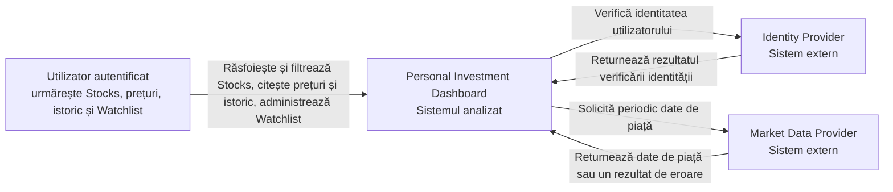
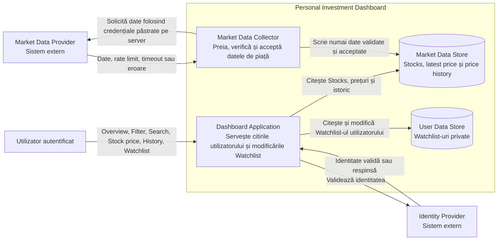
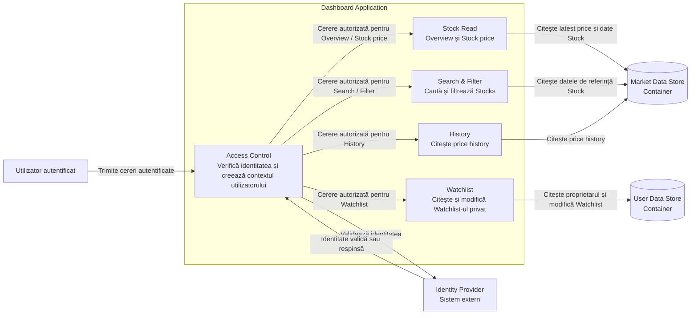
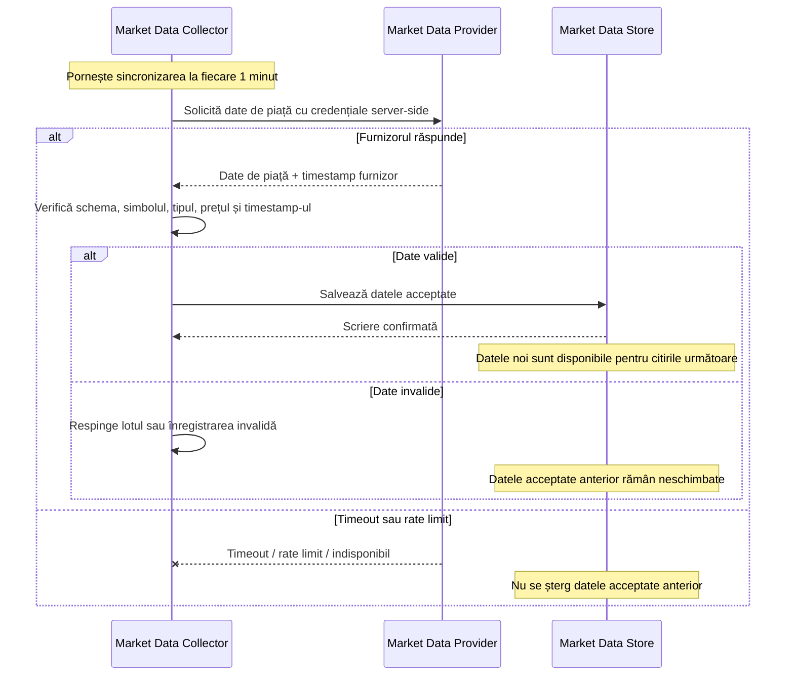
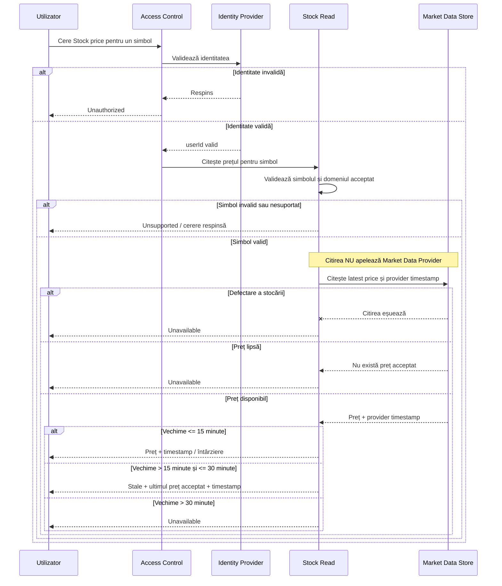
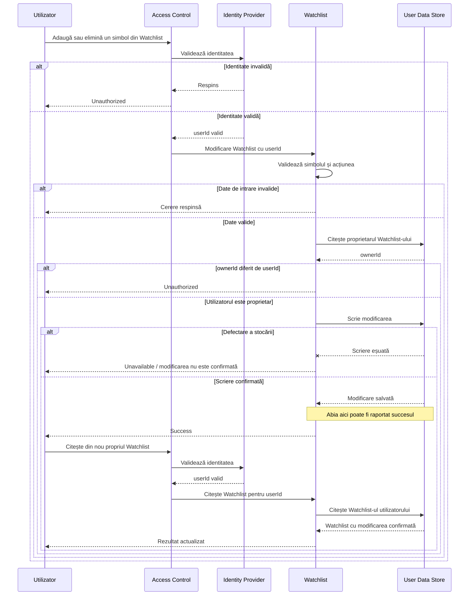

# Laboratorul 3: Desenează limita Dashboard-ului

**Autor:** Cristea Alexandru

## Personal Investment Dashboard

## Context

În primul laborator am stabilit produsul, iar în al doilea am fixat obiectivele de calitate și volumul de lucru. La nivelul maxim analizat, Dashboard-ul trebuie să poată duce aproximativ **10.296 RPS în momentul deschiderii pieței**, iar citirea `Stock price` reprezintă fluxul cu cea mai mare intensitate.

În laboratorul de față deschid granița sistemului și împart Dashboard-ul în câteva părți, fiecare cu responsabilități bine delimitate. Proiectarea rămâne intenționat de simplă. Nu adaug containere sau componente care nu sunt necesare pentru funcțiile descrise în primele două laboratoare.

Premisele pe care le folosesc în raport sunt:

- autentificarea se face printr-un **Identity Provider extern**;
- Market Data Provider rămâne un furnizor generic;
- Market Data Collector aduce datele de piață la fiecare **1 minut**;
- citirile făcute de utilizator se bazează pe datele deja sincronizate și **nu generează o cerere nouă către Market Data Provider**;
- datele publice de piață și datele private ale utilizatorului sunt ținute separat;
- fiecare utilizator poate citi și modifica exclusiv propriul Watchlist;
- după o modificare confirmată a Watchlist-ului, următoarea citire a aceluiași utilizator trebuie să reflecte modificarea;
- dacă sincronizarea cu furnizorul eșuează, ultima valoare validă nu se șterge;
- pentru Stock price păstrez regula din Laboratorul 2: până la 15 minute datele sunt acceptate împreună cu timestamp-ul, între 15 și 30 de minute rezultatul este `Stale`, iar după 30 de minute devine `Unavailable`.

# 1. Diagrama System Context

La acest nivel nu se vede structura internă a Dashboard-ului. Sunt reprezentați doar utilizatorul și sistemele externe cu care produsul comunică direct.

**Rolurile din diagramă:**

- **Utilizator autentificat** – actorul uman care interacționează direct cu sistemul.
- **Personal Investment Dashboard** – sistemul de interes.
- **Identity Provider** – confirmă identitatea utilizatorului.
- **Market Data Provider** – livrează datele de piață pe care Dashboard-ul le folosește.

Market Data Provider poate răspunde cu date întârziate, cu date invalide, poate limita numărul de cereri sau poate fi indisponibil. Dashboard-ul rămâne responsabil pentru felul în care aceste situații ajung la utilizator.

# 2. Diagrama Container

În acest view deschid granița Dashboard-ului. Folosesc patru containere interne, suficiente pentru funcțiile și regulile stabilite până acum.

## Responsabilitățile containerelor

| Container | Responsabilitate |
|---|---|
| **Dashboard Application** | Primește cererile utilizatorului, verifică identitatea, validează input-ul și returnează Overview, Filter, Search, Stock price, History și Watchlist. |
| **Market Data Collector** | Sincronizează periodic datele de piață, verifică răspunsurile furnizorului și salvează doar rezultatele acceptate. |
| **Market Data Store** | Ține datele despre Stocks, ultimul preț acceptat și price history. |
| **User Data Store** | Ține Watchlist-urile private împreună cu legătura lor către proprietar. |

Separarea `Market Data Collector` de `Dashboard Application` contează pentru că citirile utilizatorilor nu trebuie să depindă de un apel nou la furnizor. Pentru 30.000 de utilizatori, Laboratorul 2 a estimat 7.920 RPS în regim stabil și 10.296 RPS la deschiderea pieței. Acest trafic nu este tratat ca trafic direct către Market Data Provider.

Prin separarea `Market Data Store` de `User Data Store`, datele publice de piață rămân distincte de datele private ale utilizatorilor.

# 3. Diagrama Component

Această diagramă deschide **numai Dashboard Application**. Market Data Collector nu este descompus aici, pentru că cerința laboratorului spune să fie deschis doar Dashboard Application.

## Responsabilitățile componentelor

| Componentă | Responsabilitate |
|---|---|
| **Access Control** | Verifică identitatea prin Identity Provider și transmite mai departe identitatea utilizatorului validat. |
| **Stock Read** | Servește Overview și Stock price și aplică regulile `Stale` / `Unavailable`. |
| **Search & Filter** | Caută și filtrează instrumentele acceptate de V1. |
| **History** | Returnează istoricul de preț disponibil pentru un Stock. |
| **Watchlist** | Verifică proprietarul și citește sau modifică Watchlist-ul privat. |

În diagramă nu apar clase, metode sau funcții. Fiecare componentă descrie o responsabilitate internă a aceluiași `Dashboard Application`.

# 4. Diagrame de secvență

## A. Sincronizarea datelor de piață

Market Data Collector pornește sincronizarea la intervale regulate. Credențialele pentru Market Data Provider rămân în partea de server și nu ajung la utilizator.

### Ipoteze pentru flux

- sincronizarea are loc la fiecare **1 minut**;
- Market Data Collector păstrează credențialele furnizorului pe server;
- utilizatorii văd datele doar după ce scrierea în Market Data Store este confirmată;
- o sincronizare eșuată nu înlocuiește datele valide cu zero și nici nu le elimină;
- dacă datele existente îmbătrânesc, Dashboard Application aplică regula de actualitate din Laboratorul 2;
- un răspuns invalid al furnizorului nu devine automat rezultat valid în Dashboard.

## B. Citirea prețului unui Stock

Citirea prețului se face din datele deja sincronizate. Nu există o cerere nouă către Market Data Provider pentru fiecare citire a utilizatorului.

### Ipoteze pentru flux

- orice cerere de citire trece mai întâi prin verificarea identității;
- simbolul este validat înainte de accesarea datelor;
- `Stock Read` citește exclusiv din Market Data Store;
- o citire obișnuită a utilizatorului **nu produce o cerere nouă către Market Data Provider**;
- un preț absent nu este afișat ca `0`;
- până la 15 minute prețul este acceptat cu timestamp-ul furnizorului;
- între 15 și 30 de minute este afișat ca `Stale`;
- după 30 de minute rezultatul devine `Unavailable`;
- o defectare a Market Data Store duce la `Unavailable`, nu la un preț inventat.

## C. Modificarea unui Watchlist privat

Succesul este raportat doar după ce modificarea a fost scrisă și confirmată în User Data Store.

### Ipoteze pentru flux

- Watchlist-ul are un proprietar identificat prin `userId`;
- proprietarul este verificat înainte de orice modificare;
- un utilizator nu poate citi sau modifica Watchlist-ul altui utilizator;
- succesul este returnat doar după confirmarea scrierii în User Data Store;
- dacă scrierea eșuează, Dashboard-ul nu susține că modificarea a fost făcută;
- după un `Success`, următoarea citire a aceluiași utilizator trebuie să includă modificarea confirmată;
- regula menține garanția `read-your-writes` definită în Laboratorul 2.

# 5. Verificarea proiectării față de Laboratorul 2

Arhitectura răspunde direct punctelor de presiune identificate în laboratorul anterior.

| Cerință sau risc | Decizie în această proiectare |
|---|---|
| Stock price generează cel mai mare trafic | `Stock Read` citește din Market Data Store și nu apelează furnizorul pentru fiecare cerere. |
| 10.296 RPS la deschiderea pieței | Traficul utilizatorilor este separat de sincronizarea furnizorului. Capacitatea reală trebuie verificată ulterior prin load testing. |
| Furnizorul poate fi lent sau indisponibil | `Market Data Collector` izolează sincronizarea de citirile utilizatorului. |
| Furnizorul poate trimite date invalide | Collector-ul validează înainte de salvare. |
| Prețurile pot deveni vechi | `Stock Read` clasifică rezultatul ca acceptat, `Stale` sau `Unavailable`. |
| Watchlist-ul este privat | `Access Control` validează identitatea, iar `Watchlist` verifică proprietarul. |
| Read-your-writes pentru Watchlist | Succesul este dat numai după scriere confirmată; următoarea citire vede modificarea. |

Estimarea de 10.296 RPS creează o cerință de capacitate, dar nu demonstrează singură că arhitectura poate susține volumul. Confirmarea se obține prin măsurare și testare de încărcare.

# 6. Concluzie

Proiectarea se sprijină pe patru containere interne:

- Dashboard Application;
- Market Data Collector;
- Market Data Store;
- User Data Store.

Dashboard Application are cinci responsabilități principale: Access Control, Stock Read, Search & Filter, History și Watchlist.

Fluxul de market data rămâne separat de citirile utilizatorului. Când Market Data Provider are timeout, rate limit sau trimite date invalide, datele acceptate anterior rămân disponibile și sunt evaluate după regulile de actualitate. Astfel, o problemă a furnizorului nu se transformă automat într-un rezultat fals pentru utilizator.

Datele private sunt tratate separat. Watchlist-ul poate fi modificat doar de proprietar, iar succesul este raportat numai după confirmarea scrierii.

Această structură acoperă cerințele actuale și nu introduce încă tehnologii concrete, produse cloud sau detalii de implementare care nu sunt cerute de laborator.

## Surse de curs

- Laboratorul 3: **Desenează limita Dashboard-ului**.
- Lecția 3: **Cerințe de calitate, volum de lucru și capacitate**.
- Laboratorul 2: **Cuantifică citirile Dashboard-ului**.
- C4 Model: System Context, Container și Component views.
