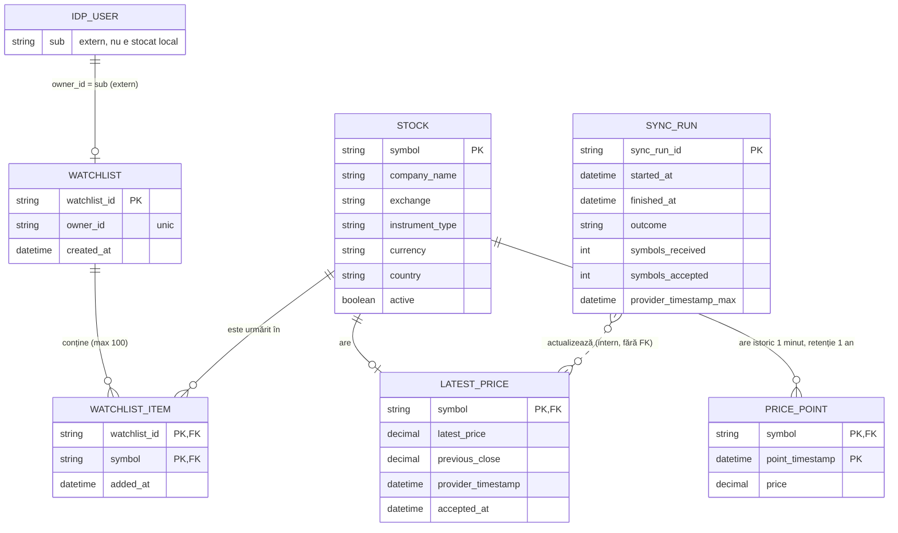
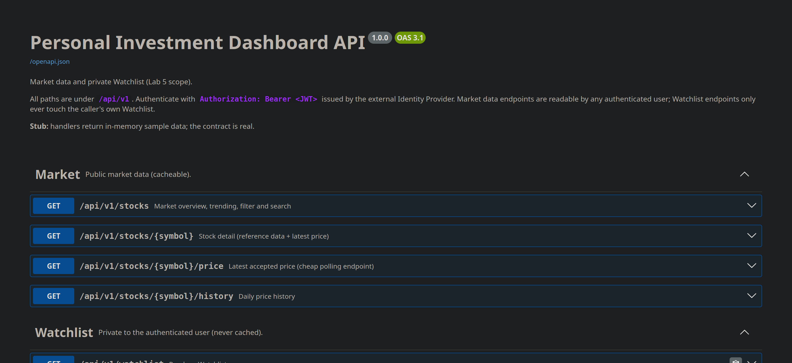
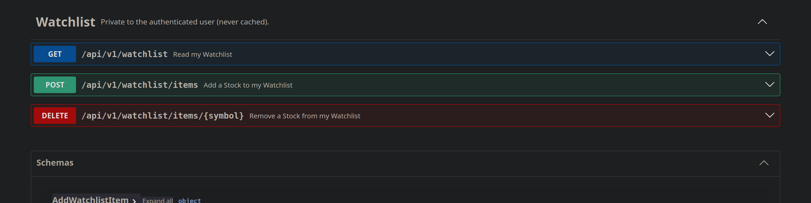
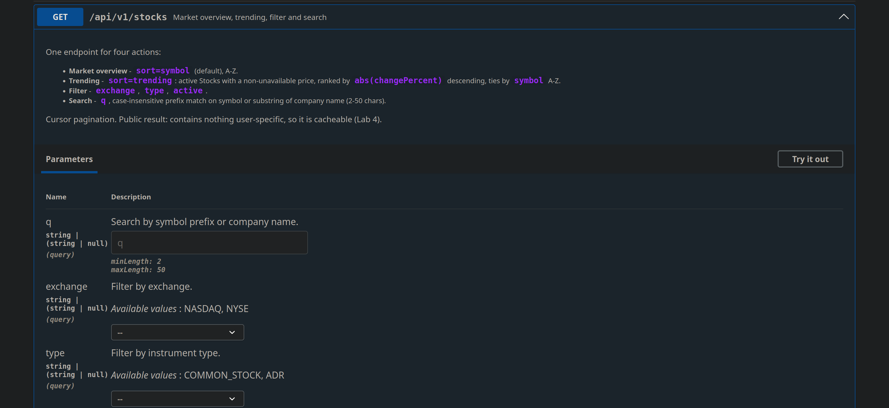

# Laboratorul 5: Modelează Dashboard-ul și definește API-ul

**Autor:** Cristea Alexandru

## Personal Investment Dashboard

## Context

În primele patru laboratoare am definit produsul, obiectivele de calitate, granița sistemului și traseul de citire la scară. În continuare prezint **modelul de date** și **API-ul HTTP** pentru domeniul de piață și pentru Watchlist, iar la final obțin OpenAPI dintr-un cod sursă aliniat proiectării.

```text
Model de date -> endpoint-uri -> definiții în cod -> OpenAPI -> flux client
```

Reguli preluate din laboratoarele anterioare:

- autentificarea se face printr-un Identity Provider extern (nu există tabel local `User` și nici endpoint-uri de login);
- cererile utilizatorului nu ajung la Market Data Provider; Collector-ul este o integrare de server, nu un endpoint pentru client;
- prospețimea se judecă după **provider timestamp**: ≤ 15 min `current`, 15–30 min `stale`, peste 30 min sau valoare absentă `unavailable`; lipsa unui preț nu se afișează niciodată ca `0`;
- Watchlist-ul este privat, nu ajunge în cache-ul comun și respectă *read-your-writes*;
- piața SUA, Nasdaq + NYSE, common stock + ADR; titlurile delistate se păstrează pentru istoric.

Rămân în afara scopului: Orders, Holdings, profit/pierdere, SSE, partajare publică.

---

# 1. Modelul de date

## 1.1 Entități

| Entitate | Scop | Identitate | Relații | Proprietar |
|---|---|---|---|---|
| `stock` | Date de referință pentru Search/Filter/detaliu | `symbol` | 1 — 1 `latest_price`; 1 — N `price_point`; 1 — N `watchlist_item` | Market Data Store (scris doar de Collector) |
| `latest_price` | Ultimul preț acceptat pentru Stock price/Overview | `symbol` (și FK către `stock`) | N — 1 `stock` (cel mult unul pe Stock) | Market Data Store |
| `price_point` | Un punct de preț la 1 minut pentru History | (`symbol`, `point_timestamp`) | N — 1 `stock` | Market Data Store |
| `sync_run` | Înregistrare **internă** a unei sincronizări Collector (diagnostic, cât de proaspete sunt datele) | `sync_run_id` | nu are FK către utilizator; referă simbolurile doar prin numere agregate | Market Data Store, **neexpusă** clientului |
| `watchlist` | Lista privată a unui utilizator | `watchlist_id`; `owner_id` unic | 1 — N `watchlist_item`; aparține unui utilizator extern | User Data Store |
| `watchlist_item` | Un Stock urmărit | (`watchlist_id`, `symbol`) | N — 1 `watchlist`; N — 1 `stock` | User Data Store |
| *Utilizator (extern)* | Identitate emisă de Identity Provider | `sub` din token → `owner_id` | referit doar prin `owner_id` | Identity Provider, nu îl stocăm |

## 1.2 Diagrama ER



Cine deține datele: `stock`, `latest_price`, `price_point` și `sync_run` sunt scrise exclusiv de Market Data Collector. `watchlist` și `watchlist_item` sunt modificate exclusiv de Dashboard, în numele proprietarului indicat de token.

## 1.3 Câmpuri

Câmpurile păstrate în stocare sunt `snake_case`, iar în API apar `camelCase`. Tipurile SQL, constrângerile și indexurile urmează în etapa următoare.

### `stock`

| Câmp stocat | Câmp API | Semnificație | Exemplu | Valoare lipsă |
|---|---|---|---|---|
| `symbol` | `symbol` | Ticker, majuscule, identitate | `AAPL` | obligatoriu |
| `company_name` | `name` | Denumirea companiei | `Apple Inc.` | obligatoriu; înregistrarea fără nume este respinsă la sincronizare |
| `exchange` | `exchange` | `NASDAQ` sau `NYSE` | `NASDAQ` | obligatoriu |
| `instrument_type` | `type` | `COMMON_STOCK` sau `ADR` | `COMMON_STOCK` | obligatoriu |
| `currency` | `currency` | Moneda cotației | `USD` | implicit `USD` (piața SUA) |
| `country` | `country` | Țara listării | `US` | implicit `US` |
| `active` | `active` | `false` dacă este delistat/inactiv (nu mai poate intra în Watchlist; istoricul rămâne) | `true` | obligatoriu; înlocuiește `status` din Lab 2 (`ACTIVE`/`DELISTED` → boolean) |

### `latest_price`

| Câmp stocat | Câmp API | Semnificație | Exemplu | Valoare lipsă |
|---|---|---|---|---|
| `symbol` | `symbol` | Stock-ul | `AAPL` | obligatoriu |
| `latest_price` | `price` | Ultimul preț **acceptat** | `231.42` | `null` → `state = unavailable`; niciodată `0` |
| `previous_close` | `previousClose` | Închiderea anterioară | `229.10` | `null` → `change`/`changePercent` sunt `null` |
| `provider_timestamp` | `providerTimestamp` | Ora sursei (furnizorului) | `2026-10-08T14:29:00-04:00` | `null` → `unavailable` |
| `accepted_at` | — (intern) | Când l-a acceptat Collector-ul; **nu** înlocuiește `provider_timestamp` | `2026-10-08T14:29:08-04:00` | obligatoriu |

### `price_point`

| Câmp stocat | Câmp API | Semnificație | Exemplu | Valoare lipsă |
|---|---|---|---|---|
| `symbol` | `symbol` | Stock-ul | `AAPL` | obligatoriu |
| `point_timestamp` | (în `date`) | Minutul sursei | `2026-10-08T14:29:00-04:00` | obligatoriu |
| `price` | `open/high/low/close` (agregat) | Preț la acel minut | `231.42` | punctul lipsă **nu este creat**; zilele fără date sunt omise din răspuns |

### `watchlist` / `watchlist_item`

| Câmp stocat | Câmp API | Semnificație | Exemplu | Valoare lipsă |
|---|---|---|---|---|
| `watchlist.owner_id` | — (niciodată în API) | `sub` din token | `idp\|user-123` | obligatoriu, unic |
| `watchlist_item.symbol` | `symbol` | Stock urmărit | `AAPL` | obligatoriu |
| `watchlist_item.added_at` | `addedAt` | Momentul confirmării scrierii | `2026-10-08T09:12:44-04:00` | obligatoriu, setat de server |

### `sync_run` (intern)

`sync_run_id`, `started_at`, `finished_at`, `outcome` (`success` / `partial` / `failed`), `symbols_received`, `symbols_accepted`, `provider_timestamp_max`. Un `outcome = failed` **nu șterge** ultimele valori valide din `latest_price` (regula din Lab 3).

## 1.4 Fapte stocate vs. valori derivate

| Valoare | Tip | Cum se obține |
|---|---|---|
| `latest_price`, `previous_close`, `provider_timestamp`, `active`, `added_at` | stocată | scrisă de Collector / Dashboard |
| `state` (`current`/`stale`/`unavailable`) | **derivată** | din `now − provider_timestamp` la momentul citirii, cu pragurile 15/30 min. *Schimbare față de Lab 2*: nu o stochez (`price_state`), fiindcă se schimbă fără nicio scriere |
| `ageSeconds` | derivată | `now − provider_timestamp` |
| `change`, `changePercent` | derivate | `price − previous_close`; `change / previous_close × 100` |
| `count` din Watchlist | derivată | numărul de `watchlist_item` |
| bare zilnice `open/high/low/close/pointCount` | derivate | agregare a `price_point` pe zi de tranzacționare (max 390 puncte/zi) |
| `hasMore`, `nextCursor` | derivate | din ordonare și limită |

## 1.5 Clasamentul „Trending”

`sort=trending` înseamnă Stock-uri **active** cu `state ≠ unavailable`, sortate descrescător după `abs(changePercent)` și apoi după `symbol` A–Z (ordine totală, deci cursorul rămâne stabil). Un Stock fără preț valid nu poate fi încadrat în clasament și este lăsat deoparte (nu primește `0`). Regula este simplă, ușor de explicat și se calculează din datele deja sincronizate; volumul nu face parte din model.

---

# 2. Endpoint-uri client

Bază: `https://api.dashboard.example/api/v1` (domeniu fictiv). Toate cer `Authorization: Bearer <JWT>`.

## 2.1 Inventar

| Acțiune de produs | Metodă și cale | Parametri / corp | Succes | Acces |
|---|---|---|---|---|
| Market overview | `GET /api/v1/stocks` | `sort=symbol` (implicit), `limit`, `cursor` | `200` pagină | autentificat; date publice |
| Trending | `GET /api/v1/stocks?sort=trending` | `limit`, `cursor` | `200` pagină | autentificat; date publice |
| Filtrare | `GET /api/v1/stocks` | `exchange`, `type`, `active` | `200` pagină | autentificat; date publice |
| Căutare după nume/simbol | `GET /api/v1/stocks` | `q` (2–50 caractere) | `200` pagină | autentificat; date publice |
| Detaliu Stock | `GET /api/v1/stocks/{symbol}` | `symbol` | `200` | autentificat; date publice |
| Ultimul preț acceptat | `GET /api/v1/stocks/{symbol}/price` | `symbol` | `200` | autentificat; date publice |
| Istoric zilnic | `GET /api/v1/stocks/{symbol}/history` | `from`, `to` | `200` | autentificat; date publice |
| Citire Watchlist | `GET /api/v1/watchlist` | — | `200` | **doar proprietarul** (din token) |
| Adăugare în Watchlist | `POST /api/v1/watchlist/items` | corp `{ "symbol" }` | `201` (nou) / `200` (exista) | doar proprietarul |
| Eliminare din Watchlist | `DELETE /api/v1/watchlist/items/{symbol}` | `symbol` | `204` | doar proprietarul |

Un singur `GET /stocks` acoperă patru acțiuni (overview, trending, filtrare, căutare) prin parametri. Niciun endpoint nu primește `userId`: proprietarul este luat **doar** din token, așa că nu se poate cere Watchlist-ul altui utilizator.

## 2.2 Politici comune

| Politică | Decizie |
|---|---|
| **Versiune** | În cale: `/api/v1`. *Schimbare compatibilă*: adăugarea unui câmp opțional în răspuns (de ex. `volume`) sau a unui filtru opțional — clienții ignoră câmpurile necunoscute. *Schimbare incompatibilă*: redenumirea `changePercent` sau schimbarea semnificației `state` → `/api/v2`, `v1` rămâne activ o perioadă de tranziție. |
| **Autentificare** | JWT „Bearer” emis de Identity Provider extern; Dashboard verifică semnătura, `exp`, `aud`; `sub` = `owner_id`. Lipsă/invalid/expirat → `401` + `WWW-Authenticate: Bearer`. |
| **Autorizare** | Fiecare citire/modificare de Watchlist filtrează pe `owner_id = sub`. Datele de piață sunt aceleași pentru toți utilizatorii autentificați. |
| **Paginare** | Cursor opac. `limit` 1–100, implicit 20. Răspuns `page: { limit, nextCursor, hasMore }`. `nextCursor = null` la ultima pagină. Cursorul este valid doar cu aceiași filtre și același `sort`; altfel `400 invalid_cursor`. Watchlist (max 100) și istoricul (max 366 zile) sunt mărginite, deci fără cursor. |
| **Rate limit `429`** | Pe utilizator. Răspunsul include `Retry-After` (secunde). Clientul oprește cererile pe acel endpoint, așteaptă cel puțin `Retry-After`, reîncearcă cu *backoff* exponențial + jitter (max 3 încercări) și afișează ultimele date cu marcajul vechimii. Cererile de modificare se reîncearcă doar fiindcă sunt idempotente (§2.3). |
| **Format de eroare** | Unul singur pentru orice non-2xx. |
| **Statusuri** | `200/201/204`; `400` input invalid; `401`; `404`; `409` conflict de stare; `429`; `503` stocare indisponibilă. |
| **Timp** | ISO 8601 cu offset. Prețurile sunt numere, moneda `USD`. |

Eroare (același format peste tot):

```json
{
  "error": {
    "code": "invalid_request",
    "message": "One or more parameters are invalid.",
    "details": [{ "field": "limit", "issue": "must be between 1 and 100" }],
    "requestId": "req_8f3a1c"
  }
}
```

Coduri folosite: `invalid_request`, `invalid_cursor`, `unauthorized`, `stock_not_found`, `stock_inactive`, `watchlist_full`, `watchlist_item_not_found`, `rate_limited`, `unavailable`.

Comunicarea Collector → Market Data Provider rămâne o **integrare de server** (pull o dată pe minut). Ea nu are endpoint pentru client, iar copiile din cache (L1/Redis din Lab 4) nu expun nici ele un endpoint.

## 2.3 Detalii pe operație

### `GET /api/v1/stocks` — overview / trending / filtru / căutare

| Parametru | Validare | Implicit |
|---|---|---|
| `q` | 2–50 caractere; prefix pe `symbol` sau subșir în nume, fără diferență majuscule/minuscule | — |
| `exchange` | `NASDAQ` \| `NYSE` | toate |
| `type` | `COMMON_STOCK` \| `ADR` | toate |
| `active` | boolean | `true` (delistatele se văd doar cu `active=false`) |
| `sort` | `symbol` \| `trending` | `symbol` |
| `limit` | întreg 1–100 | 20 |
| `cursor` | opac | prima pagină |

Sortarea este `symbol` A–Z sau `trending` (§1.5). Răspunsul este un `StockPage` și nu depinde de utilizator, deci poate fi cache-uit ca în Lab 4.

**Pagină filtrată** — `GET /api/v1/stocks?exchange=NASDAQ&type=COMMON_STOCK&q=app`

```json
{
  "items": [
    {
      "symbol": "AAPL", "name": "Apple Inc.", "exchange": "NASDAQ", "type": "COMMON_STOCK", "active": true,
      "price": { "symbol": "AAPL", "price": 231.42, "previousClose": 229.1, "change": 2.32, "changePercent": 1.01,
                 "currency": "USD", "state": "current", "providerTimestamp": "2026-10-08T14:29:00-04:00", "ageSeconds": 60 }
    }
  ],
  "page": { "limit": 20, "nextCursor": null, "hasMore": false }
}
```

**Rezultat gol** — `GET /api/v1/stocks?q=zz` → `200` (nu `404`):

```json
{ "items": [], "page": { "limit": 20, "nextCursor": null, "hasMore": false } }
```

**Trending, prima pagină** — `GET /api/v1/stocks?sort=trending&limit=2` returnează `TSM` (`+3.98%`, `state: "stale"`) apoi `AAPL` (`+1.01%`), `hasMore: true` și un `nextCursor`.

Erori: `400` (`limit=500`, `cursor` invalid, `q` prea scurt), `401`, `429`, `503`.

### `GET /api/v1/stocks/{symbol}` — detaliu

`200`:

```json
{
  "symbol": "AAPL", "name": "Apple Inc.", "exchange": "NASDAQ", "type": "COMMON_STOCK", "active": true,
  "country": "US", "currency": "USD",
  "price": { "symbol": "AAPL", "price": 231.42, "previousClose": 229.1, "change": 2.32, "changePercent": 1.01,
             "currency": "USD", "state": "current", "providerTimestamp": "2026-10-08T14:29:00-04:00", "ageSeconds": 60 }
}
```

`symbol`: 1–10 caractere `[A-Za-z][A-Za-z0-9.-]*`, insensibil la majuscule. Erori: `400`, `401`, `404 stock_not_found`.

### `GET /api/v1/stocks/{symbol}/price` — ultimul preț acceptat

Returnează același obiect `price`; este endpoint-ul folosit pentru reîmprospătare, deoarece Stock price are cel mai mare volum (600 RPS la 3.000 de utilizatori). Cele trei stări:

```json
{ "symbol": "AAPL", "price": 231.42, "previousClose": 229.1, "change": 2.32, "changePercent": 1.01, "currency": "USD", "state": "current",     "providerTimestamp": "2026-10-08T14:29:00-04:00", "ageSeconds": 60 }
{ "symbol": "TSM",  "price": 301.55, "previousClose": 290.0, "change": 11.55, "changePercent": 3.98, "currency": "USD", "state": "stale",       "providerTimestamp": "2026-10-08T14:10:00-04:00", "ageSeconds": 1200 }
{ "symbol": "OLDCO","price": null,   "previousClose": null,  "change": null,  "changePercent": null, "currency": "USD", "state": "unavailable", "providerTimestamp": null, "ageSeconds": null }
```

`unavailable` este un rezultat **valid** (`200`) cu `price: null`, nu o eroare HTTP și nu `0`. `503` rămâne pentru cazul în care nici Market Data Store, nici cache-ul nu pot răspunde.

### `GET /api/v1/stocks/{symbol}/history` — istoric zilnic

| Parametru | Validare | Implicit |
|---|---|---|
| `from` | dată `YYYY-MM-DD`, inclusiv | `to` − 29 zile |
| `to` | dată, inclusiv | astăzi |

`from ≤ to` și intervalul ≤ 366 zile (retenție 1 an) altfel `400`. Ordine: crescător după dată; max 366 elemente. Funcționează și pentru Stock-uri delistate.

```json
{
  "symbol": "AAPL", "interval": "1d", "from": "2026-10-06", "to": "2026-10-07",
  "items": [
    { "date": "2026-10-06", "open": 227.9, "high": 230.1, "low": 226.8, "close": 229.1, "pointCount": 390 },
    { "date": "2026-10-07", "open": 229.3, "high": 232.0, "low": 228.7, "close": 231.0, "pointCount": 390 }
  ]
}
```

Zilele pentru care nu există date nu apar în listă și nu sunt umplute cu `0`.

### `GET /api/v1/watchlist`

Listă privată, citită mereu din User Data Store (niciodată din cache-ul partajat), așa că reflectă orice modificare deja confirmată. Intrările delistate rămân, cu `active: false` și `price.state = unavailable`. Ordinea: cele mai noi primele.

```json
{
  "items": [
    { "symbol": "AAPL", "name": "Apple Inc.", "active": true, "addedAt": "2026-10-08T09:12:44-04:00",
      "price": { "symbol": "AAPL", "price": 231.42, "previousClose": 229.1, "change": 2.32, "changePercent": 1.01,
                 "currency": "USD", "state": "current", "providerTimestamp": "2026-10-08T14:29:00-04:00", "ageSeconds": 60 } }
  ],
  "count": 1,
  "limit": 100
}
```

Watchlist gol: `{ "items": [], "count": 0, "limit": 100 }` cu `200`.

### `POST /api/v1/watchlist/items`

Corp (doar câmpul din client; `addedAt`, `owner` sunt controlate de server și nu sunt acceptate):

```json
{ "symbol": "AAPL" }
```

| Caz | Răspuns |
|---|---|
| adăugat | `201` + `WatchlistItem` (la fel ca elementul de mai sus) |
| era deja în listă | `200` + elementul existent (idempotent, sigur la retry) |
| `symbol` nevalid | `400 invalid_request` |
| Stock inexistent | `404 stock_not_found` |
| Stock delistat | `409 stock_inactive` |
| 100 de elemente | `409 watchlist_full` |
| scriere eșuată | `503 unavailable` — nu s-a modificat nimic, UI nu afirmă succesul |

Răspunsul de succes apare **doar după** ce scrierea este confirmată (Lab 3, secvența C).

### `DELETE /api/v1/watchlist/items/{symbol}`

`204` fără corp după confirmare. `404 watchlist_item_not_found` dacă simbolul nu este în Watchlist-ul apelantului (un simbol aflat în Watchlist-ul altcuiva produce același răspuns: nu se dezvăluie existența lui). Funcționează și pentru intrări delistate. Erori: `400`, `401`, `429`, `503`.

---

# 3. OpenAPI generat din cod

## 3.1 Sursa

Framework: **FastAPI** (Pydantic v2).

| Fișier | Rol |
|---|---|
| [`app/main.py`](app/main.py) | rute, modele, validări, erori, autentificare, exemple. **Handlerele sunt stub-uri** marcate `STUB`, cu date de probă în memorie |
| [`generate_openapi.py`](generate_openapi.py) | scrie `openapi.json` și `openapi.yaml` din `app.openapi()` |
| [`requirements.txt`](requirements.txt) | dependențe |
| [`openapi.yaml`](openapi.yaml) / [`openapi.json`](openapi.json) | documentul generat |

Câmpurile expuse de API sunt `camelCase` datorită `alias_generator=to_camel` (în cod modelele rămân `snake_case`). Erorile de validare Pydantic (implicit `422`) sunt transformate în `400`, cu formatul unic de eroare.

## 3.2 Comenzi

```bash
cd SD/lab-5
python3 -m venv .venv && . .venv/bin/activate
pip install -r requirements.txt
python generate_openapi.py                      # -> openapi.json, openapi.yaml
uvicorn app.main:app --reload                   # Swagger UI: http://127.0.0.1:8000/docs
```

## 3.3 Verificare

Documentul a fost verificat cu `openapi-spec-validator` (pe `openapi.json`): `OK`. În continuare am comparat inventarul din §2.1 cu `paths` din document:

| Inventar §2.1 | În OpenAPI (`operationId`) | Exemple în document |
|---|---|---|
| overview / trending / filtru / căutare | `GET /api/v1/stocks` (`listStocks`) | `trending_page`, `filtered_page`, `empty`; erori `400/401/429/503` |
| detaliu | `GET /api/v1/stocks/{symbol}` (`getStock`) | `200`, `404` |
| preț | `GET /api/v1/stocks/{symbol}/price` (`getStockPrice`) | `current`, `stale`, `unavailable` |
| istoric | `GET /api/v1/stocks/{symbol}/history` (`getStockHistory`) | `200`, `400` interval invalid |
| citire Watchlist | `GET /api/v1/watchlist` (`getWatchlist`) | `with_items`, `empty` |
| adăugare | `POST /api/v1/watchlist/items` (`addWatchlistItem`) | `201`, `200`, `400`, `404`, `409` |
| eliminare | `DELETE /api/v1/watchlist/items/{symbol}` (`removeWatchlistItem`) | `204`, `404` |

Cele șapte rute din document acoperă cele zece acțiuni din inventar (patru acțiuni sunt servite de `listStocks`). Am rulat fiecare exemplu cu `TestClient` pe stub-uri: pagină filtrată (`200`), listă goală (`200`), `limit=500` → `400` în formatul unic de eroare, fără token → `401`, simbol necunoscut → `404`, `POST` dublu → `201` apoi `200`, delistat → `409`, `DELETE` → `204`, al doilea `DELETE` → `404`, pagina a doua cu `cursor` → `200`.

Capturi din Swagger UI (`uvicorn app.main:app`, pagina `/docs`), generate din documentul produs:







Documentul poate fi deschis și în [Swagger Editor](https://editor.swagger.io/) (lipește `openapi.yaml`).

---

# 4. Flux client

```text
Deschide Stock-urile trending -> deschide un Stock pentru mai multe date -> adaugă-l în Watchlist
```

Token-ul vine de la Identity Provider (în afara API-ului descris aici) și însoțește fiecare cerere:
`Authorization: Bearer eyJhbGciOi…`. Bază: `https://api.dashboard.example/api/v1`.

## 4.1 Apeluri în ordine

| # | Apel | Scop |
|---|---|---|
| 1 | `GET /stocks?sort=trending&limit=10` | lista trending |
| 2 | `GET /stocks/TSM` | ecranul de detaliu: date de referință + ultimul preț |
| 3 | `GET /stocks/TSM/history?from=2026-09-09&to=2026-10-08` | graficul zilnic (30 de zile) |
| 4 | `GET /stocks/TSM/price` | reîmprospătarea prețului (repetat, respectând `429`) |
| 5 | `POST /watchlist/items` cu `{"symbol":"TSM"}` | adăugare în Watchlist |
| 6 | `GET /watchlist` | confirmare/reafișare a listei (read-your-writes) |

După ce utilizatorul alege Stock-ul, pașii 2–4 pot fi lansați în paralel.

Exemple (pașii 1, 2, 5 — răspunsurile sunt cele din §2.3):

```http
GET /api/v1/stocks?sort=trending&limit=10 HTTP/1.1
Host: api.dashboard.example
Authorization: Bearer eyJhbGciOi…
```
→ `200`, `items[0].symbol = "TSM"`, `price.state = "stale"`.

```http
GET /api/v1/stocks/TSM HTTP/1.1
Authorization: Bearer eyJhbGciOi…
```
→ `200` cu `StockDetail` (`price.state` = `stale`, `providerTimestamp` = `2026-10-08T14:10:00-04:00`).

```http
POST /api/v1/watchlist/items HTTP/1.1
Authorization: Bearer eyJhbGciOi…
Content-Type: application/json

{ "symbol": "TSM" }
```
→ `201`:
```json
{ "symbol": "TSM", "name": "Taiwan Semiconductor Manufacturing", "active": true, "addedAt": "2026-10-08T14:31:02-04:00",
  "price": { "symbol": "TSM", "price": 301.55, "previousClose": 290.0, "change": 11.55, "changePercent": 3.98,
             "currency": "USD", "state": "stale", "providerTimestamp": "2026-10-08T14:10:00-04:00", "ageSeconds": 1262 } }
```

## 4.2 Ce arată UI

| Ecran / apel | Încărcare | Succes | Listă goală | Eroare |
|---|---|---|---|---|
| Trending (1) | schelet de listă (rânduri placeholder) | rânduri cu simbol, nume, preț, `changePercent`; `stale` apare ca „preț vechi · 20 min”, cu timpul furnizorului, nu ca preț curent | „Nu există Stock-uri trending acum” (de ex. piață închisă / date indisponibile) | banner „Nu am putut încărca lista” + buton *Reîncearcă*; la `429`, mesaj cu așteptarea din `Retry-After`; la `401`, redirect către autentificare |
| Detaliu (2, 4) | schelet pentru antet și preț | preț + variație + ora furnizorului; la `unavailable` se afișează „Preț indisponibil” (niciodată `0`) | — | `404` → „Stock-ul nu există”; altfel eroare locală, ultimul preț rămâne cu marcajul vechimii |
| Grafic (3) | schelet de grafic | linie zilnică; zilele fără date sunt goluri în linie | „Nu există istoric pentru perioadă” (`items: []`) | doar graficul arată eroare + *Reîncearcă*; restul ecranului rămâne utilizabil |
| Adaugă în Watchlist (5) | butonul este dezactivat cu indicator de progres, fără a afișa succesul înainte de răspuns | butonul devine „În Watchlist ✓”; `200` (exista deja) se tratează la fel | — | `409 stock_inactive` → „Stock delistat, nu poate fi adăugat”; `409 watchlist_full` → „Watchlist plin (100)”; `503`/timeout → „Nu s-a salvat”, butonul rămâne activ (retry sigur: operația e idempotentă); `401` → autentificare |
| Watchlist (6) | schelet | listă cu prețuri; intrările delistate marcate „Delistat” | „Watchlist-ul tău este gol” | eroare cu *Reîncearcă*; fără valori inventate |

---

# 5. Concluzie

- Modelul ține separate datele de piață (scrise de Collector) de datele private (scrise de Dashboard). Utilizatorul rămâne o identitate externă, la care se face referire doar prin `owner_id`.
- `state` și variația se **calculează la citire**; dacă prețul lipsește, valoarea este `null`, niciodată `0`.
- Zece acțiuni de produs sunt acoperite de șapte rute; `GET /stocks` singur deservește overview, trending, filtrare și căutare, ceea ce se aliniază cu cache-ul public din Lab 4.
- Watchlist-ul nu primește `userId` de la client și nu este pus în cache partajat, așa că rămâne privat și respectă *read-your-writes*.
- Operațiile de modificare sunt idempotente (`POST` repetat → `200`, `DELETE` → `404` explicit), deci pot fi reîncercate în siguranță după `429` sau timeout.
- `openapi.yaml` este generat din cod și validat; documentul include exemple pentru pagină filtrată, listă goală și eroare.

## Surse de curs

- Lecția 6: API design și modelare de date (`lectures/lecture-06-api-design-and-data-modeling-ro.md`)
- Laboratoarele 1–4 (reguli de produs, calitate, limita sistemului, cache)
